<!-- Visual assets are generated by scripts/build_profile_assets.py. Edit the script, then re-run it. -->

  <a href="https://apsis-dx.com"></a>

  <a href="https://apsis-dx.com"><b>Website</b></a>&nbsp;&nbsp;·&nbsp;&nbsp;<a href="https://apsis-dx.com/blog"><b>Blog</b></a>&nbsp;&nbsp;·&nbsp;&nbsp;<a href="https://apsis-dx.com/signals"><b>Signals</b></a>&nbsp;&nbsp;·&nbsp;&nbsp;<a href="https://apsis-dx.com/works"><b>Works</b></a>&nbsp;&nbsp;·&nbsp;&nbsp;<a href="https://apsis-dx.com/contact"><b>Contact</b></a>

 

  
  
  

  <a href="https://apsis-dx.com/blog"></a>
  <a href="https://apsis-dx.com/signals"></a>
  <a href="https://apsis-dx.com/works"></a>

  <a href="https://github.com/apsis-org/template-gas-monorepo"></a>
  <a href="https://github.com/apsis-org/template-slack-monorepo"></a>
  <a href="https://github.com/apsis-org/template-teams-bot"></a>

  

  <a href="https://github.com/Cloud-Xero"></a>
  <a href="https://github.com/takuma531zov"></a>

  For press, media, or project inquiries, reach out via our <a href="https://apsis-dx.com/contact"><b>contact page</b></a> or at <a href="mailto:info@apsis-dx.com"><b>info@apsis-dx.com</b></a>.

  

